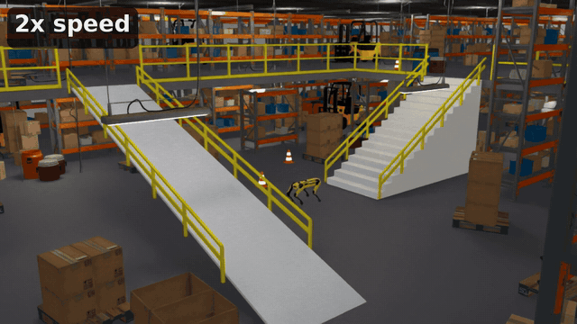
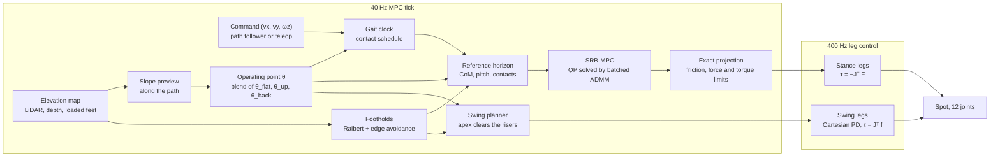

# rl_mpc

Model-based stair and ramp controller for the Spot quadruped in [Isaac Lab](https://isaac-sim.github.io/IsaacLab/): a batched GPU convex single-rigid-body MPC with a clock gait, terrain-aware footholds, CMA-ES-tuned ascent and backward-descent operating points, and an optional PPO residual. No learning in the baseline.

This repository compares two ways of improving a model-based legged controller: **learning a residual on top of the MPC with RL (PPO)**, and **searching the MPC's own parameters offline with CMA-ES**. Both are applied to the same controller, in the same simulated warehouse, and scored by the same measure: how many robots finish the route.

<p align="center">
  
  <br>
  <em>One robot, the pure MPC with no learned residual, walking the 90 m loop in the two-floor warehouse at 2x speed: up the staircase, across the upper floor, down and back up the ramp, then backward down the stairs. The upper floor is partly out of frame from this camera.</em>
</p>

**Contents:** [1. Problem statement](#1-problem-statement) · [2. MPC for legged robots in industrial environments](#2-mpc-for-legged-robots-in-industrial-environments-and-the-baseline) · [3. RL-augmented MPC](#3-rl-augmented-mpc-residuals-and-ppo) · [4. CMA-ES-reinforced MPC](#4-cma-es-reinforced-mpc-parameter-search-and-assumptions) · [5. Results](#5-results) · [6. Limitations](#6-limitations) · [Getting started](#getting-started)

---

## 1. Problem statement

Industrial sites such as warehouses put legged robots on several floors joined by stairs and ramps, between racks, pallets and forklifts. The task here is a **90 m inspection loop** in a two-floor warehouse: up a 16-step staircase, along the upper floor, down a ramp and back up another, then down the staircase again, with no human help and with a controller that can be inspected and debugged.

Stairs are the hard part. Footholds are discontinuous, a foot has to clear a riser edge, and a descent hides the next tread from forward-looking sensors. A model-based controller handles friction and force limits explicitly, but its stair performance hangs on a handful of hand-tuned numbers, and the outcome is a chaotic function of them (see the evidence in [section 4](#4-cma-es-reinforced-mpc-parameter-search-and-assumptions)).

The question this repository asks:

> Given a working but hand-tuned MPC, is it better to **add a learned policy inside the control loop** (RL residuals), or to **tune the controller's own parameters offline** (CMA-ES)?

Everything is measured in simulation (Isaac Sim / PhysX), with the robot's true state as feedback.

---

## 2. MPC for legged robots in industrial environments, and the baseline

### Environment

- **Robot:** Boston Dynamics Spot, 12 actuated joints, simulated as pure torque sources limited by the stock torque model. One environment step is one **40 Hz MPC tick** (ten 400 Hz physics steps).
- **Main benchmark:** a 40 × 33 m two-floor warehouse with a 16-step staircase (rise 0.1875 m, run 0.30 m, width 2.0 m), an 18° ramp, an open atrium, racks, pallets and forklifts (`spot_mpc/worlds/warehouse_static/`). Yellow guard rails run along the atrium edge and beside the stair and the ramp; they stop the robot but are not in the sensed map (`rails=False` removes them), and the ramp's rails start 1.6 m up the slope so the route can turn onto the foot from the side. The stairs and ramp are light against the dark floor so the robot's black feet show on them. The route is split into segments (`stairs_up`, `ramp_down`, `stairs_down_back`, ...) and the full `loop_back` of 25 waypoints.
- **Also:** a simple test world (flat, stairs, descent, ramp, rubble) and **procedurally generated terrain** with ten tile families on a difficulty curriculum, used for training and for held-out evaluation.
- **Sensing:** LiDAR, a forward depth camera (and a rear one when walking backward) and foot contacts are fused into a 2.5D **elevation map** around the robot, with an upper-bound layer and a stair-pattern prior that fills the treads a descending robot cannot see. The controller plans on this sensed map, not on the true terrain.

### Control stack

At 40 Hz: update the map, preview the terrain along the commanded path, choose the operating point, build the reference horizon, footholds and contact schedule, solve the QP, re-plan the swing legs. At 400 Hz: stance legs apply the MPC force, swing legs track a trajectory.



### Single-rigid-body model

The state is $x=[\Theta,\ p,\ \omega,\ v,\ g]\in\mathbb R^{13}$: roll-pitch-yaw, centre-of-mass position, angular velocity, linear velocity, and a constant slot for gravity. The input is the four stance-foot forces, $u=[f_1;f_2;f_3;f_4]\in\mathbb R^{12}$. With $r_i$ the foot-minus-CoM vector, $m$ the mass, and $I_w=R_z(\psi)\thinspace I_b\thinspace R_z(\psi)^\top$ the body inertia rotated by the reference yaw:

$$
\dot p=v,\qquad m\thinspace \dot v=\sum_i f_i+m g,\qquad \dot\omega=I_w^{-1}\sum_i r_i\times f_i,\qquad \dot\Theta\approx R_z(\psi)^\top\omega .
$$

Discretised with step $\Delta t=0.025$ s (second-order terms in position and attitude), a foot force changes the state by

$$
\Delta v=\tfrac{\Delta t}{m}f_i,\quad \Delta p=\tfrac{\Delta t^2}{2m}f_i,\quad \Delta\omega=\Delta t\thinspace I_w^{-1}[r_i]_\times f_i,\quad \Delta\Theta=\tfrac{\Delta t^2}{2}R_z^\top I_w^{-1}[r_i]_\times f_i ,
$$

giving $x_{k+1}=A_kx_k+B_ku_k$, with $A_k,B_k$ rebuilt every tick from the horizon's foot positions and yaw.

### Quadratic program

Over a horizon of $H=16$ steps (0.4 s), stacking $X=[x_1;\dots;x_H]$ and $U=[u_0;\dots;u_{H-1}]$ gives $X=X_\text{free}(x_0)+B_qU$ (condensing). The cost tracks a reference trajectory with diagonal weights $Q$ and penalises force magnitude and force rate:

$$
\min_U\ \sum_{k=1}^{H}\Vert x_k-x_k^\text{ref}\Vert _Q^2+r_\alpha\Vert u_{k-1}\Vert ^2+r_{\Delta}\Vert u_{k-1}-u_{k-2}\Vert ^2
\quad\Longleftrightarrow\quad
\min_U\ \tfrac12U^\top PU+q^\top U ,
$$

with $P=2B_q^\top QB_q+2r_\alpha I+2r_\Delta D^\top D$ and $q=2B_q^\top Q\thinspace (X_\text{free}-X^\text{ref})$ (plus the force-rate term on the previous force). Constraints, per foot and per step:

$$
|f_x|\le\mu f_z,\quad |f_y|\le\mu f_z,\quad 0\le f_z\le f_\text{max}\ \text{(stance)},\quad f=0\ \text{(swing)},\quad \big|(-J^\top f)_j\big|\le\tau_j^\text{max}.
$$

The friction pyramid ($\mu=0.6$), the force bound ($f_\text{max}=220$ N) and the three joint-torque rows per foot are all linear in $f$, so the problem stays a QP.

### Solver and exact feasibility

The QP is solved for every robot at once on the GPU by an OSQP-style ADMM with a **fixed** number of iterations ($K=30$, $\rho=0.003$, $\sigma=10^{-6}$, over-relaxation $\alpha=1.6$), warm-started from the previous tick shifted by one step:

$$
\tilde x=(P+\sigma I+\rho A^\top A)^{-1}\big(\sigma x-q+A^\top(\rho z-y)\big),\quad
z^{+}=\Pi_{[\ell,u]}\Big(\alpha A\tilde x+(1-\alpha)z+\tfrac{y}{\rho}\Big),\quad
y^{+}=y+\rho\big(\alpha A\tilde x+(1-\alpha)z-z^{+}\big).
$$

A fixed iteration count is not a converged solution, so the applied force is not the raw iterate. The first-step force is **projected exactly** onto the constraints: zero it on swing feet, clip $f_z$ to $[0,f_\text{max}]$, clip $f_{x,y}$ to $\pm\mu f_z$, then scale the foot's force down if any joint torque would exceed its limit. Constraint satisfaction on the applied step therefore holds by construction.

### Gait, footholds and swing

- **Clock trot:** frequency 2 Hz, duty 0.6, phase offsets $(0,\tfrac12,\tfrac12,0)$.
- **Footholds (Raibert):** the touchdown point of foot $i$ is
  $p_i^\text{td}=c_{xy}(t_\text{td})+R(\psi)\thinspace n_i+\tfrac{T_\text{st}}{2}\thinspace v+k_d\thinspace (v-v^\text{des})$,
  with the correction capped and $n_i$ the nominal hip offset. The point is then moved to the best of a 5 × 5 grid of shifts within ±0.08 m: a candidate is penalised when the terrain around it deviates from a local plane by more than the flat tolerance (2 cm), so uniform slopes cost nothing and riser edges repel the foot. Its height is read from the elevation map.
- **Body reference:** height $z^\text{ref}=h_\text{des}+\overline h(\text{four nominal feet})$ and pitch $\theta^\text{ref}=-\arctan\frac{\bar h_\text{front}-\bar h_\text{rear}}{L}$, so the body follows the terrain under it.
- **Swing:** a smoothstep path with the smallest apex that clears the terrain by a margin $c$. Because the vertical profile is linear in the apex, every sample $s$ along the swing gives a lower bound $z_\text{apex}\ge\frac{h_\text{max}(s)+c-\text{const}(s)}{\text{coeff}(s)}$, and the apex is the largest of them.

### The baseline and its operating point

All the numbers above that shape the gait ($k_d$, apex, clearance, foothold margin, swing gains, duty, frequency, the weights in $Q$, the crouch) form an **operating point** $\theta$. The baseline is the **hand-tuned forward trot** with one flat-ground operating point, walking the staircases facing forward. Spot descends stairs far better *backward*, which needed the slope logic to be direction-aware (the pitch sign, vertical-speed reference, speed governor and lane keeping all refer to the direction of travel); that is the first step up from the baseline in the results.

The controller can switch between operating points. The previewed pitch over the horizon, in the direction of travel $s=\pm1$, gives an ascent and a descent steepness

$$
a=\max_k\big(-s\thinspace \theta_k^\text{ref}\big)_+,\qquad d=\max_k\big(s\thinspace \theta_k^\text{ref}\big)_+,\qquad
w_\text{up}=\mathrm{clip}\big(\tfrac{a}{\theta_s}\big)\thinspace [\text{forward}],\quad w_\text{back}=\mathrm{clip}\big(\tfrac{d}{\theta_s}\big)\thinspace [\text{backward}],
$$

with $\theta_s=0.15$ rad, and every scheduled parameter is blended as

$$
\theta(t)=\theta_\text{flat}+w_\text{up}\thinspace (\theta_\text{up}-\theta_\text{flat})+w_\text{back}\thinspace (\theta_\text{back}-\theta_\text{flat}).
$$

On flat ground the controller is exactly the baseline. The two other sets are what the next two sections try to improve: section 3 by learning a correction every tick, section 4 by searching for the best $\theta_\text{up}$ and $\theta_\text{back}$ offline.

---

## 3. RL-augmented MPC: residuals and PPO

### Idea

Keep the MPC, and let a neural policy add small **residuals** to what the MPC computes. The policy sees the robot's proprioception and a short terrain scan; its output is added at the 40 Hz tick. A zero action is exactly the pure MPC, so the baseline is always recoverable.

### Residual action space

The policy outputs $a\in[-1,1]^{23}$: 19 residuals and 4 tuning outputs.

| output | size | where it acts |
|---|---|---|
| gait frequency | 1 | $f=f_\text{op}+\Delta f_\text{max}\thinspace a_f$ (rate-limited) |
| body acceleration | 6 | a constant linear/angular acceleration added to the SRB prediction over the horizon, rotated from body to world frame |
| foothold | 8 | $p_i^\text{td}\mathrel{+}=R(\psi)\thinspace s_\text{foot}\thinspace a_{\text{foot},i}$ (±2 cm) |
| swing apex | 4 | $z_{\text{apex},i}\mathrel{+}=s_\text{apex}\thinspace a_{\text{apex},i}$ (±2 cm) |
| tuning ("meta") | 4 | speed scale $1+0.35\thinspace a_0$; velocity weight $\times e^{a_1}$; duty $+0.05\thinspace a_2$; pitch weight $\times e^{a_3}$ |

The acceleration residual enters the model as a disturbance $d_k(\hat a)$: $x_{k+1}=A_kx_k+B_ku_k+d_k(\hat a)$, so the QP still enforces the force constraints on the corrected prediction. Residuals are rate-limited, and in the lane task they are gated to where the scan shows a riser.

### Training

- **Algorithm:** PPO ([rsl-rl](https://github.com/leggedrobotics/rsl_rl)) with clipped objective $L=\mathbb E\big[\min\big(r_t\hat A_t,\ \mathrm{clip}(r_t,1\pm\epsilon)\hat A_t\big)\big]$, $\epsilon=0.1$, GAE ($\gamma=0.99$, $\lambda=0.95$), learning rate either fixed at $3\cdot10^{-5}$ or KL-adaptive (target KL 0.01, starting at $10^{-4}$, $\epsilon=0.2$), actor and critic MLPs of $[512,256,128]$, 256 parallel robots, 24 steps per environment per update, up to 1500 iterations.
- **Exploration:** a small initial action noise ($\sigma_0=0.08$), because stair success is knife-edge in the controller and a noise level of 0.3 halved it.
- **Observation:** body velocity and angular velocity in the body frame, gravity direction, command, joint positions and velocities, gait phase and contact schedule, measured foot loads, previous action, the previewed pitch and steepness, and a terrain scan. The critic additionally sees contact forces, the MPC's commanded forces and the true height above the floor.
- **Reward (dense, shaped):** progress (forward distance plus $3\times$ height gained), velocity tracking $\exp(-\Vert v-v^\text{cmd}\Vert ^2/\sigma^2)$, an orientation penalty on $\phi^2+(\theta-\theta^\text{ref})^2$, an action-rate penalty, a penalty for legs or body touching terrain, an overspeed penalty on descents, tracking of the vertical speed the slope asks for, and terminal terms (fall −10, success +20). Reaching the goal **terminates** the episode, so PPO does not bootstrap a value past it; running out of time is a **truncation**, which PPO bootstraps and which carries no penalty (a penalty would also need the time left in the observation, which the policy does not see). The general task adds **Lagrangian safety costs** (unloaded stance, a tilt barrier with a control-barrier-function condition, overspeed, link contact) whose multipliers grow while a running cost exceeds its budget.
- **Logging and provenance:** every iteration logs the KL step of the policy, its mean action size and the action noise; every checkpoint stores the environment and PPO configuration (including the CMA-ES operating points it was trained against), the git commit and any uncommitted code diff.
- **Tasks:** `lanes` (hand-made test-world lanes) and `general` (procedural terrain, ten tile families on a difficulty curriculum, with domain randomisation of friction 0.45–1.25, added mass −2 to +4 kg, motor strength ±10%, random pushes and 1 cm sensor noise).

```bash
python scripts/train.py --task general --num_envs 256 --headless
# with the KL-adaptive learning rate
python scripts/train.py --task general --num_envs 256 --headless \
    --agent_set "algorithm.schedule='adaptive'" --agent_set "algorithm.learning_rate=1e-4" --agent_set "algorithm.clip_param=0.2"
```

Eight PPO residual runs were made. The first six (Lagrangian safety costs, a tilt shield, a stair-focused fine-tune) reported reaching the goal as a time-out, which PPO bootstraps as if the episode carried on, and also penalised the real time-out while bootstrapping it. The last two were retrained after fixing that, one with the fixed and one with the KL-adaptive learning rate, against the current (CMA-ES) controller. The result is in [section 5](#5-results): **no net gain in either case**. Two checkpoints are kept for reproducibility: `results/best.pt` (the best of the first six, trained before the CMA-ES operating points existed and without a record of its configuration) and `results/best_adaptive_lr.pt` (the adaptive-rate retrain, iteration 1000, picked on a separate terrain seed; its configuration is stored inside it).

---

## 4. CMA-ES-reinforced MPC: parameter search and assumptions

### Idea

Instead of learning a function of the state, find the best **constant** values of the controller's own parameters, once, offline. The parameters of the ascent and backward-descent operating points are searched with CMA-ES, a derivative-free evolution strategy, scoring each candidate by how many simulated robots complete the staircase. The result is two small parameter tables that drop into the blend of section 2.

### Why a black-box search

Staircase success is a binary, chaotic function of both the parameters and the initial state. With identical start poses all 256 robots succeeded; a spawn perturbation of only ±2 cm and 0.01 rad dropped that to 189/256; and 128 identical no-jitter robots fell 122 times while four identical robots all succeeded. The outcome is not differentiable in any useful sense, the parameters interact (gait frequency, crouch, foothold margin and swing gains each had narrow optima in one-at-a-time sweeps), and the metric we care about is a success rate. A population-based search that scores each candidate over many random starts fits this directly.

### Formulation

Each operating point has $d$ scheduled parameters $\theta_j\in[\ell_j,u_j]$ ($d=10$ for ascent, $d=11$ for backward descent), searched in a unit box $s\in[0,1]^d$ with $\theta_j=\ell_j+s_j(u_j-\ell_j)$, or $\theta_j=\ell_j(u_j/\ell_j)^{s_j}$ for scale-like parameters (e.g. the velocity weight).

- **Ascent** ($d=10$): `stair_speed`, `q_vel_xy_steep`, `slope_crouch`, `gait_duty_up`, `gait_freq_up`, `swing_clearance_up`, `swing_base_apex_up`, `foot_margin_up`, `swing_kp_up`, `swing_kd_up`.
- **Backward descent** ($d=11$): `stair_speed_back`, `q_vel_xy_back`, `gait_duty_back`, `gait_freq_back`, `swing_clearance_back`, `swing_base_apex_back`, `foot_margin_back`, `q_pitch_back`, `descent_crouch_back`, `swing_kp_back`, `swing_kd_back`.

**Objective** (maximised): over $B=96$ robots started from jittered poses on the staircase,

$$
f(s)=\underbrace{\tfrac1B\textstyle\sum_b \mathbb 1[\text{robot } b \text{ completes}]}_{\text{success fraction}}\ -\ 0.002\cdot\overline{t}_\text{done},
$$

where the second term is a small preference for faster completion. Ascent is scored over `stairs_up` from a standstill 1.2 m before the first riser (34 s limit); backward descent from the upper landing to the bottom (26 s limit). The policy action is zero throughout: CMA-ES tunes the pure MPC.

**CMA-ES** keeps a Gaussian over the unit box. Each generation samples $\lambda=8$ candidates $s_i\sim m+\sigma\thinspace \mathcal N(0,C)$, ranks them by $f$, and updates

$$
m\leftarrow\sum_{i=1}^{\mu}w_i\thinspace s_{i:\lambda},\qquad
C\leftarrow(1-c_1-c_\mu)\thinspace C+c_1\thinspace p_cp_c^\top+c_\mu\sum_{i=1}^{\mu}w_i\thinspace y_{i:\lambda}y_{i:\lambda}^\top ,
$$

with $y_{i:\lambda}=(s_{i:\lambda}-m_\text{old})/\sigma$, the evolution path $p_c$ and step-size adaptation (pycma defaults). The mean starts at the hand-tuned operating point, $\sigma_0=0.2$ in unit coordinates, and bounds are handled by pycma's boundary transformation. The search ran 12 generations (ascent) and 14 generations (descent).

### Assumptions

State these before trusting the numbers:

1. **Regime-specific parameters.** Each set only acts in its own regime through the blend $w_\text{up}$, $w_\text{back}$. The backward set is valid only while walking backward; applying the descent parameters globally destroyed ascent (stairs up 12%, loop 9%).
2. **One staircase geometry.** Both searches only saw the warehouse staircase: rise 0.1875 m, run 0.30 m. Other geometries are a held-out question, not something the search covers.
3. **Box constraints.** The optimum is only sought inside the bounds. The hand-tuned point is inside the box and is the starting mean. The v1 bounds were binding: `foot_margin` ended on its lower bound (0.05) in both searches, and the descent mean put `swing_kd` on its upper bound (40). `scripts/tune_cma.py` now has wider bounds for these and, at the end, re-scores the default, the mean and the best candidate on an unseen seed.
4. **Simulation only.** Actuators are ideal torque sources without delay; sensors are ray-cast against the same mesh that defines the colliders.

```bash
python scripts/tune_cma.py --mode up   --pop 8 --gens 12 --num_envs 96 --headless
python scripts/tune_cma.py --mode down --pop 8 --gens 14 --num_envs 96 --headless
```

The search logs are in `results/cma/`; the adopted values are the defaults in `spot_mpc/env/cfg.py`. `descent_back_v1.json` comes from an earlier version of the script that searched the global parameters (`gait_freq`, `swing_kp`, `foot_margin`, `stair_speed_down`, ...) while scoring only the descent; the values were then copied into the `*_back` fields. The current script searches the `*_back` fields directly and starts from the hand-tuned values, so a re-run will not reproduce that log exactly.

### How the two approaches differ

| | RL residual (PPO) | CMA-ES parameter search |
|---|---|---|
| optimisation | a network $a=\pi(o)$ that outputs 23 numbers every 40 Hz tick | 10 or 11 constant numbers per operating point |
| training signal | dense shaped reward plus safety costs, gradient-based | one scalar: success fraction over 96 robots, derivative-free |
| cost | 256 robots × up to 1500 iterations, one run per reward design | 8 candidates × 96 robots × 12–14 generations |
| interpretability | opaque policy; zero action recovers the baseline | every number is a named controller parameter you can read |
| failure mode | perturbs a knife-edge system every tick; reward is a proxy for success | overfits to the geometry and the benchmark it was scored on |

---

## 5. Results

All numbers: pure MPC unless stated, sensed elevation map, true state, 0.45 m/s command. Success is the fraction of independently spawned robots that finish. With $n=32$–$256$ the 95% interval is roughly ±5 to ±17 percentage points, so read them as distributions.

### The warehouse loop (90 m, 25 waypoints)

| configuration | completed |
|---|---|
| hand-tuned forward trot (baseline) | 38% |
| + backward stair descent (direction-aware slope logic) | 62% |
| + CMA-ES descent point | 75% |
| + CMA-ES ascent point | **86–91%** (55/64, 55/64 and 29/32 on three seeds) |

The remaining falls (8–9 of 64) are on the staircases, mostly the descent. These loop numbers may predate the stair and ramp rails becoming colliders and the dense scene becoming the default (both arrived in commit `a6741de`, together with these tables); re-run them on the current defaults before comparing with new results.

### Single-staircase held-out checks (128 robots, a different seed)

| | hand-tuned | CMA-ES distribution mean | CMA-ES best |
|---|---|---|---|
| backward descent | 71% | 82% | 87% |
| ascent | 90% | 98% (126/128) | 99% |

### Held-out generated terrain (256 robots, fresh terrain seed, domain randomisation on)

Goal rate by difficulty band:

| | easy | mid | hard |
|---|---|---|---|
| forward trot, hand-tuned | 87% | 73% | 56% |
| + backward descent | 87% | 71% | 56% |
| + CMA-ES operating points | 90% | 79% | 66% |

These three rows were measured together on 2026-10-07 (terrain seed 12345). The controller has changed since in ways that touch generated terrain, and the current code gives 84 / 80 / 62% for the last row on the same seed (87 / 78 / 68% on seed 777), so compare rows within this table, not with the one below. The CMA-ES points improved every band, most on the hardest. The gain is concentrated in descents and up-down stairs; ramps are unchanged within noise.

### RL residual versus zero residual

Current code, held-out generated terrain (256 robots per seed, domain randomisation on, one episode each), goal rate by band (easy / mid / hard). Every policy is compared with the zero residual robot by robot on the same tiles, starts and randomisation; *net* is robots only the policy brought to the goal minus robots only the zero residual did, over both seeds, with an exact McNemar test.

| | seed&nbsp;12345 (easy&nbsp;/&nbsp;mid&nbsp;/&nbsp;hard) | seed&nbsp;777 (easy&nbsp;/&nbsp;mid&nbsp;/&nbsp;hard) | goals (of&nbsp;512) | net vs zero, *p* |
|---|---|---|---|---|
| zero residual (pure MPC) | 84&nbsp;/&nbsp;80&nbsp;/&nbsp;62% | 87&nbsp;/&nbsp;78&nbsp;/&nbsp;68% | 390 | |
| `results/best.pt` (first six runs) | 85&nbsp;/&nbsp;80&nbsp;/&nbsp;59% | 83&nbsp;/&nbsp;82&nbsp;/&nbsp;68% | 388 | −2,&nbsp;*p*&nbsp;=&nbsp;0.92 |
| retrained, fixed learning rate (iteration 1499) | 85&nbsp;/&nbsp;82&nbsp;/&nbsp;62% | 80&nbsp;/&nbsp;81&nbsp;/&nbsp;67% | 388 | −2,&nbsp;*p*&nbsp;=&nbsp;0.92 |
| retrained, adaptive learning rate, `best_adaptive_lr.pt` (iteration 1000) | 85&nbsp;/&nbsp;80&nbsp;/&nbsp;54% | 84&nbsp;/&nbsp;81&nbsp;/&nbsp;67% | 380 | −10,&nbsp;*p*&nbsp;=&nbsp;0.35 |

Warehouse stairs (dense scene, 64 robots on each of seeds 1 and 2, summed):

| | stairs up | backward descent |
|---|---|---|
| zero residual | 122 / 128 | 115 / 128 |
| retrained, fixed learning rate | 126 / 128 | 116 / 128 |
| retrained, adaptive learning rate | 123 / 128 | 112 / 128 |

None of the differences is significant. The retrained checkpoints were picked as the best of three (iterations 500, 1000, 1499) on a third terrain seed, 2024, where they led the zero residual by 16 and 20 goals of 255; that lead did not hold on the held-out seeds, which is what picking the best of a few noisy scores does. Individual outcomes are chaotic: even `best.pt`, whose actions are tiny, changes the result for about 100 of 512 robots, half each way. Across all eight PPO runs, **the residual never beat the zero action**.

### Why we think RL did not help here

This is our reading of the measurements, not a proven cause:

- The outcome is already a knife-edge, chaotic function of small perturbations (section 4). A policy that perturbs the controller on every tick adds exactly that kind of noise, and the tolerable noise is tiny (0.3 action noise halved stair success).
- The training reward is a dense proxy (progress, tracking, tilt) for a sparse event (finishing the staircase). The policy can improve the proxy without improving the event.
- The retrain rules out the episode-end handling as the cause: with goal-reaching as a termination, an honest time limit, a measured KL step and an adaptive learning rate, the result did not change. The policies did move further from the MPC (mean action about 0.05–0.08 against 0.04 for `best.pt`), so it is not a policy stuck at its starting point either.
- CMA-ES optimises the event itself, with the controller's own structure (the friction and torque constraints, the clock gait) left intact.

None of this says RL residuals cannot work; it says that for this controller, this benchmark and these reward designs, offline parameter search was the better use of the same simulator.

---

## 6. Limitations

- **Simulation only.** Actuators are ideal torque sources without delay, the state is ground truth (no estimator), and the sensors are ray-cast against the same mesh that defines the colliders. Nothing here is validated on hardware.
- **One tuning geometry.** The CMA-ES points were tuned on one staircase (rise 0.1875 m, run 0.30 m). Generalisation to other geometries is partial: the hard held-out band is still only 66%.
- **Descent is the weak point.** Descent falls are forward-pitch flips driven by feet the clock schedules in stance but that are not yet loaded; ascent falls are roll flips mid-staircase. `--set contact_aware=True` gives such a foot no MPC force and keeps it reaching down until it is loaded; `--set terrain_cone=True` puts the friction pyramid about the sensed surface normal instead of world z (on the 18° ramp the world-z pyramid allows forces that slip). Neither has been benchmarked yet, so both are off by default.

---

## Getting started

**Requirements:** [Isaac Lab](https://isaac-sim.github.io/IsaacLab/) with Isaac Sim 5.1 and a CUDA GPU (the scripts import `isaaclab` and use its Spot asset, so run them with the Python environment where it is installed); `pycma` (`pip install cma`) for the search; `rsl-rl` through `isaaclab_rl` for PPO; `imageio` with ffmpeg for `--video`. The unit tests need `torch`, `numpy`, `trimesh` and `rtree`.

<!-- TODO: exact install steps and the Isaac Lab commit/tag you tested against. -->

Run from the repository root with the Isaac Lab Python:

```bash
# the controller on the test world: flat, stairs, descent, ramp_down, traverse, ramp, rubble
python scripts/run.py --scenario stairs --num_envs 32 --lane_keep --headless

# the two-floor warehouse: one route segment at a time, or the whole loop
python scripts/run_warehouse.py --segment stairs_up --num_envs 64 --headless
python scripts/run_warehouse.py --segment stairs_down_back --num_envs 64 --headless
python scripts/run_warehouse.py --segment loop_back --num_envs 32 --seed 11 --headless

# the same 25-waypoint loop with the PPO residual policy instead of the pure MPC
python scripts/run_warehouse.py --segment loop_back --num_envs 32 --seed 11 --checkpoint results/best.pt --headless
python scripts/run_warehouse.py --segment loop_back --num_envs 32 --seed 11 --checkpoint results/best_adaptive_lr.pt --headless

# (the warehouse is the full scene by default: racks, pallets, box piles, barrels and forklifts, dressed with
#  the real models and guard rails whenever there is a window or a video; --empty gives the bare building)

# a video of robot 0 (use few robots)
python scripts/run_warehouse.py --segment stairs_up --num_envs 1 --video outputs/stairs_up.mp4 --video_every 2 --headless

# look at the building in a window (run without --headless)
python scripts/render_scene.py --gui

# held-out generated terrain; add --checkpoint results/best.pt (or best_adaptive_lr.pt) for a PPO residual, --per_env for paired comparisons
python scripts/eval_general.py --headless

# drive Spot yourself with the keyboard (opens the viewer; click it first)
python scripts/teleop.py
```

**Teleop keys:** `W`/`S` or up/down arrow walk forward/backward, `A`/`D` or left/right arrow step sideways, `Q`/`E` turn left/right, `+`/`-` change the speed in six steps (0.4× to 1.5× of `--speed`), `X` or space stops, `R` resets to the start, `C` jumps the camera to a chase view behind the robot and follows it until you move the camera yourself (orbit, pan, zoom), then it is yours until you press `C` again (`--follow` starts with it on; avoid `F`, it is Isaac Sim's frame-the-whole-scene key and goes white). The robot starts facing the warehouse staircase; options: `--spawn x,y,floor_z,yaw` (the upper floor is `z=3`), `--world test`, `--speed`, `--strafe`, `--yaw_rate`, `--empty` (the bare building) and `--no_visual` (collision shapes only, starts faster). The camera is yours: hold Alt and the left mouse button to orbit, middle mouse to pan, scroll to zoom (do not hold the right mouse button while driving, it flies the camera with the same WASD keys). The controller is tuned for about 0.45 m/s forward and walks stairs forward or backward; sideways steps on stairs are outside what it was tuned for. `--demo --headless` replays a scripted key sequence without a window.


Warehouse segments: `stairs_up`, `upper_cross`, `ramp_down`, `ground_turn`, `ramp_up`, `upper_return`, `stairs_down_back`, `loop_back`. The `*_back` segments walk the staircase backward and turn on a rear depth camera. Every runner takes `--set KEY=VALUE` config overrides, for example `--set stair_speed=0.45`; every controller knob is a field of `SpotMpcEnvCfg` in `spot_mpc/env/cfg.py`.

Tests (no simulator needed):

```bash
PYTEST_DISABLE_PLUGIN_AUTOLOAD=1 pytest tests     # or: python tests/test_mpc.py
```

(`PYTEST_DISABLE_PLUGIN_AUTOLOAD=1` keeps a ROS pytest plugin from breaking plain `pytest` on machines that have ROS installed.)

### Repository layout

```
spot_mpc/
  control/      mpc.py (QP, ADMM, exact projection) · gait.py (clock, references, horizon) · footholds.py · swing.py · torque_interface.py
  perception/   elevation_map.py (fusion, upper bound, stair prior) · sensors.py
  env/          cfg.py (SpotMpcEnvCfg, every controller knob) · env.py (the 40 Hz / 400 Hz loop) · scheduler.py (slope preview, blending)
  tasks/        task.py (lanes) · general_task.py (generated terrain, domain randomisation, safety costs) · ppo.py (PPO config)
  worlds/       test_world.py · generated/ (procedural terrain) · warehouse_static/ (the two-floor warehouse) · prim_world.py
  common/       collision primitives, ray-cast mesh, USD helpers
  navigation.py   waypoint path follower
  teleop.py       keyboard keys -> velocity command
scripts/        run.py · run_warehouse.py · teleop.py · eval_general.py · train.py · tune_cma.py · render_scene.py · check_route.py
tests/          simulator-free unit tests
results/        cma/*.json (the two CMA-ES searches) · best.pt (best of the first six PPO runs) · best_adaptive_lr.pt (adaptive-rate retrain)
```

Scripts import `spot_mpc` only after the Isaac app has launched (`AppLauncher`), so the package `__init__` files are empty on purpose.

## Citation

<!-- TODO: how you want it cited. -->

## License

<!-- TODO: choose one. The robot asset and simulator come from NVIDIA Isaac Lab / Isaac Sim, which have their own licences. -->
